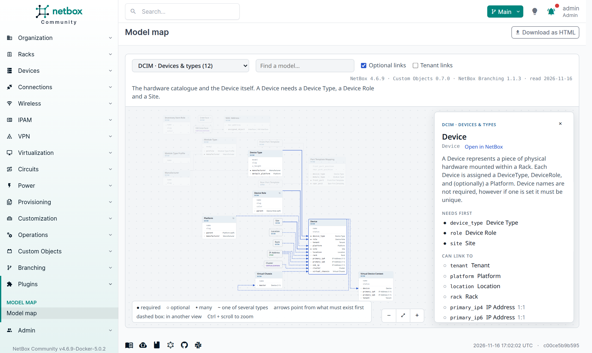

# NetBox Model Map

An interactive map of your NetBox data model, inside NetBox. It shows every core
model and every [Custom Objects](https://github.com/netboxlabs/netbox-custom-objects)
type, with the relations between them. The map is read live from your own
instance, so it always shows *your* custom object types and fields.



## What you get

- **Views per area:** an overview, DCIM in four parts (sites and racks, devices,
  components and cabling, component templates), IPAM, Virtualization, Circuits,
  Wireless, VPN and Tenancy. Every custom object group gets its own view, and
  types without a group share one.
- **Other models:** when a custom object field points at a model outside these
  apps (another plugin, tags, users), that model appears in an "Other models" view.
- **Relations on the field they come from.** Each box lists its key fields
  (required or primary, at most six) and every relation: `●` required, `○` optional, `∗` many-to-many, `~` one of
  several types (a generic relation). Arrows run from what must exist first to
  what points at it, so each view reads left to right in the order you create
  objects.
- **Dashed boxes** are models in another view; click one to go there.
- **Details panel:** click a model to see what it needs first, what it can link
  to, what references it, its rules and key fields, and a link to its list in
  NetBox. Rules come from unique constraints, custom field validation
  (min/max, regex, choice set) and your own notes (see Configuration).
- **Optional fields:** a switch that lists every field in the boxes, optional
  ones in italics. It is off by default.
- **Controls:** show or hide optional links and links to Tenant, search for a
  model, drag to pan, zoom with Ctrl + scroll, the buttons or the `+` `-` `0`
  keys. The map follows NetBox's light/dark mode.
- **Compare views:** two views side by side, each with its own view picker, details
  panel and zoom (`/plugins/model-map/?compare`, or `?compare&left=<view>&right=<view>`).
- **Download SVG or PNG:** the view on screen as an image, for documents and
  slides, with the switches as they are set and a transparent background. The
  PNG has twice the screen resolution and the map's fonts built in. Export in
  light mode for a light page: in dark mode the text is light.
- **Download as HTML:** a single file with the whole map that works without
  NetBox, for sharing. It loads the layout library and fonts from the internet
  when opened.

## Compatibility

| NetBox | Custom Objects | Branching | Status |
| --- | --- | --- | --- |
| 4.6.9 | 0.7.0 | 1.1.3 | Tested |

The plugin requires NetBox 4.6.0 or later. Custom Objects is optional: without it
the map shows the core models only (expected to work, not yet tested). The page
itself works offline; only the downloaded HTML file needs internet.

## Installation

### Plain install

```bash
source /opt/netbox/venv/bin/activate
pip install https://github.com/siemhermans/netbox-model-map/archive/refs/tags/v0.3.1.tar.gz
```

Without internet on the NetBox host, download the wheel from the
[Releases](https://github.com/siemhermans/netbox-model-map/releases) page and run
`pip install --no-deps netbox_model_map-0.3.1-py3-none-any.whl`.

To keep the plugin across NetBox upgrades, add the same URL (or the path to the
wheel) to `/opt/netbox/local_requirements.txt`.

Enable it in `configuration.py`:

```python
PLUGINS = [
    "netbox_model_map",
    # if you use netbox-branching, it must stay last
]
```

Then collect the static files and restart:

```bash
cd /opt/netbox/netbox
python manage.py collectstatic --no-input
sudo systemctl restart netbox netbox-rq
```

### Docker (netbox-docker or your own image)

Add to the Dockerfile that installs your plugins:

```dockerfile
RUN /usr/local/bin/uv pip install https://github.com/siemhermans/netbox-model-map/archive/refs/tags/v0.3.1.tar.gz \
 && cp -r "$(/opt/netbox/venv/bin/python -c 'import netbox_model_map, os; print(os.path.dirname(netbox_model_map.__file__))')/static/netbox_model_map" \
          /opt/netbox/netbox/static/
```

The `cp` is needed because the netbox-docker image collects static files when the
base image is built, before your plugins are installed. Use the tarball URL rather
than `git+https://`: the image has no `git`. Without internet during the build,
`COPY` the wheel into the image and install that instead.

Add `"netbox_model_map"` to `PLUGINS` in `configuration/plugins.py`, then rebuild
and recreate the containers.

### Check it

- **Plugins → Model map** appears in the menu, at `/plugins/model-map/`.
- **Admin → System → Plugins** lists "Model map".

## Configuration

Everything is optional. With no configuration you get the plain map.

```python
PLUGINS_CONFIG = {
    "netbox_model_map": {
        # Extra rules shown in a model's details panel, above the generated ones.
        "rules": {
            "Device": ["every production device has an asset tag"],
            "my-custom-type": ["name follows the naming standard in the wiki"],
        },
        # Replace the text under the view picker, by view name. For a custom
        # object group the view name is the group name.
        "blurbs": {
            "My group": "What these custom object types are for.",
        },
        # Models on the overview. Default: a set of core models plus every
        # custom object type.
        "overview": ["Site", "Device", "IPAddress", "my-custom-type"],
        # Extra views, listed first in the view picker: a chosen set of models.
        # Optionally hide or highlight custom object field groups in that view only.
        "views": [
            {"name": "Ordering flow", "blurb": "What the order script creates.",
             "models": ["my-custom-type", "Device", "IPAddress"],
             "show_groups": ["Request"], "hide_groups": [],
             # Fields that tie objects together by a shared value instead of a
             # relation: shown with ↔ in their own colour.
             "link_fields": ["request_id"],
             # Relation fields that map one object to another: their rows and
             # arrows get their own colour.
             "mapping_fields": ["components"]},
        ],
        # Views to leave out of the view picker, by name (still reachable by link).
        "hide_views": ["Other models"],
        # Views listed under their own heading in the view picker, by name and in
        # this order. Works for configured views and custom object group views.
        "headings": {
            "Proposal": ["Ordering flow", "My group"],
        },
    },
}
```

Model ids:

- Core models use their class name (`Device`, `IPAddress`).
- Custom object types use their slug (`my-custom-type`).
- Other models use `<app label>-<ClassName>`, e.g. `extras-Tag`.

The details panel shows each model's id under its name. Restart NetBox after
changing the configuration.

## Who can see it

Every logged-in user. When `LOGIN_REQUIRED` is off, anonymous users can see it
too. The page shows the data model only, no records. It also accepts an API
token, which is handy for scripting the download:

```bash
curl -H "Authorization: Bearer <token>" "https://netbox.example.com/plugins/model-map/?download" -o model-map.html
```

## How it works

- **Reading the model.** Every page view reads Django's model metadata for the
  core apps and the custom object type definitions. Nothing is stored, and the
  plugin has no database tables or migrations. A page view takes about 100 ms;
  the first one after a restart takes longer.
- **Generic relations.** In NetBox 4.6 these don't list their possible
  targets. The plugin takes them from the models that declare the reverse
  relation, plus NetBox's own lists of scope and termination types.
- **Layout and drawing.** Each view is laid out by [ELK](https://eclipse.dev/elk/)
  (elkjs, layered algorithm, left to right) and drawn as SVG in the browser.

## Limitations

- Read-only. Core models are code and cannot be changed; edit custom object
  types in NetBox itself.
- Models from other plugins only appear when a custom object field points at them.
- Key fields (required, non-relational fields) and the split of DCIM into four
  views are heuristics.

## Uninstall

1. Remove `"netbox_model_map"` from `PLUGINS`.
2. Run `pip uninstall netbox-model-map`.
3. Restart NetBox.

There is nothing in the database to clean up.

## Development

Build a wheel and source package with:

```bash
pip install build
python -m build
```

Both land in `dist/`. Bump `version` in `pyproject.toml` and in
`netbox_model_map/__init__.py` together.

## Changelog

**0.3.1**

- SVG and PNG downloads have a transparent background.
- The line with NetBox and plugin versions above the map is gone.

**0.3.0**

- Download the view on screen as a PNG image, at twice the screen resolution,
  with the fonts the map uses built in.

**0.2.0**

- Compare two views side by side (`?compare`).
- Download the view on screen as an SVG image.
- Configurable views (`views`, with `show_groups`, `hide_groups`, `link_fields`
  and `mapping_fields`) and `hide_views`.
- `headings`: list views under their own heading in the view picker.
- **Optional fields** switch: every field in the boxes, optional ones in italics.
  Off by default, so the boxes look the same as in 0.1.0.

**0.1.0**

- First release.

## License

Apache License 2.0, see [LICENSE](LICENSE).

The plugin bundles [elkjs](https://github.com/kieler/elkjs) 0.9.3, which is
licensed under the Eclipse Public License 2.0; see
[`elk-LICENSE.md`](netbox_model_map/static/netbox_model_map/elk-LICENSE.md).
